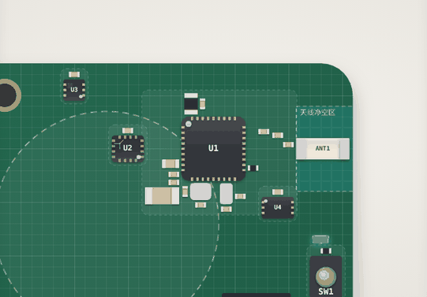
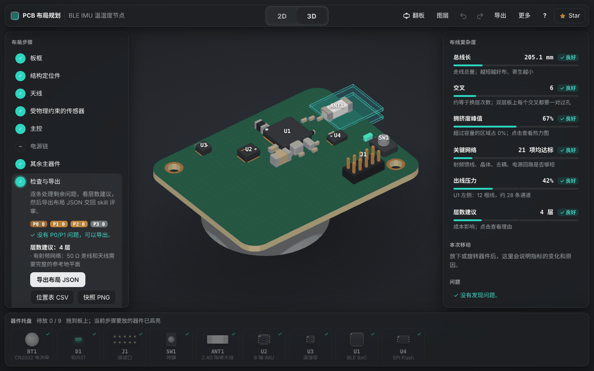
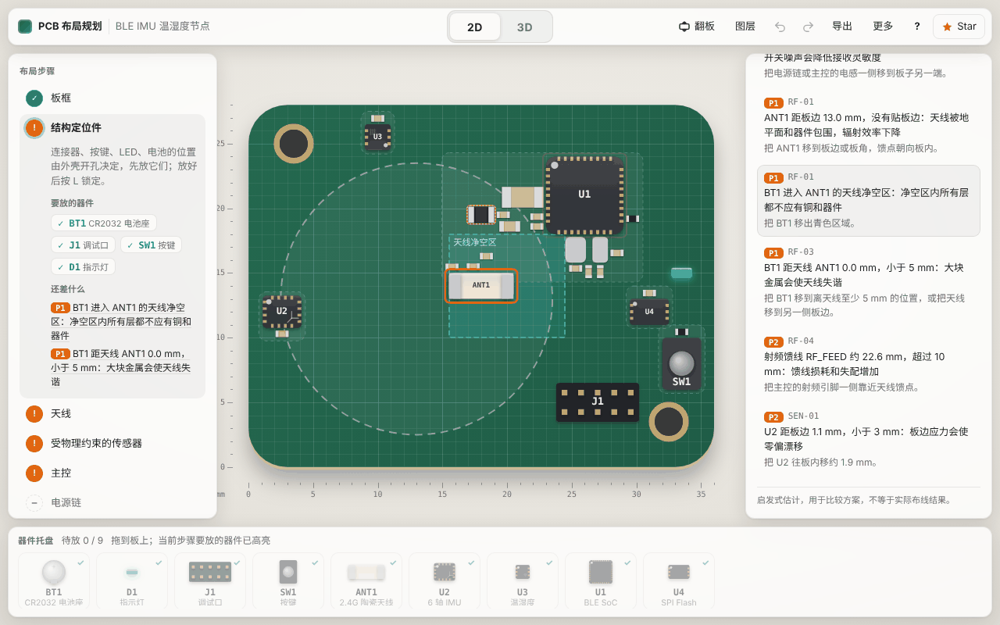
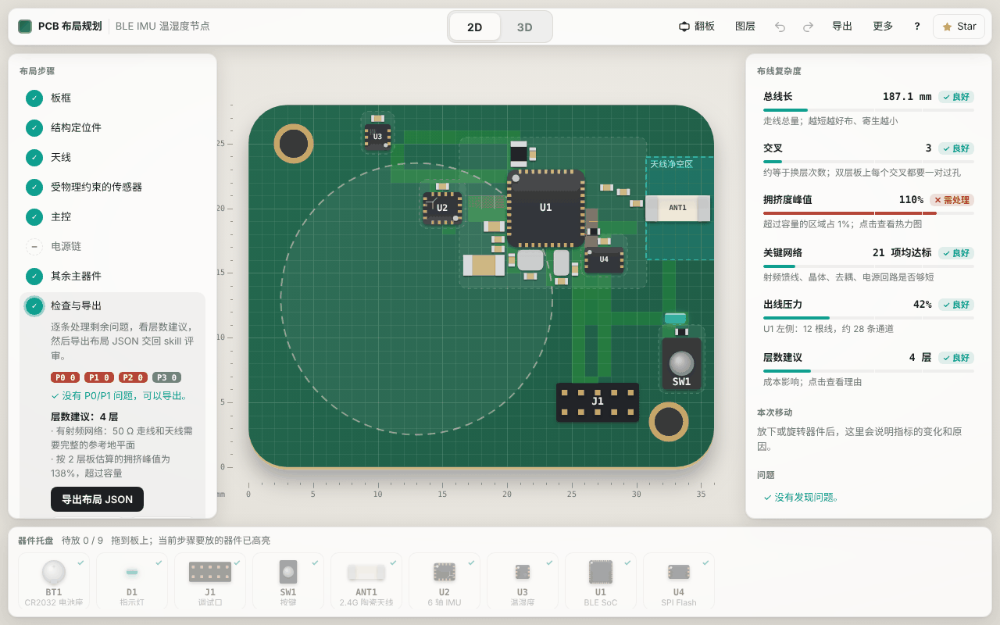
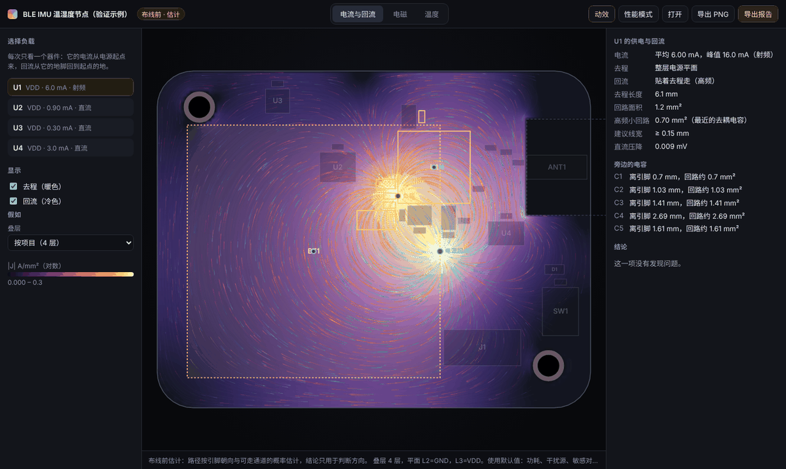
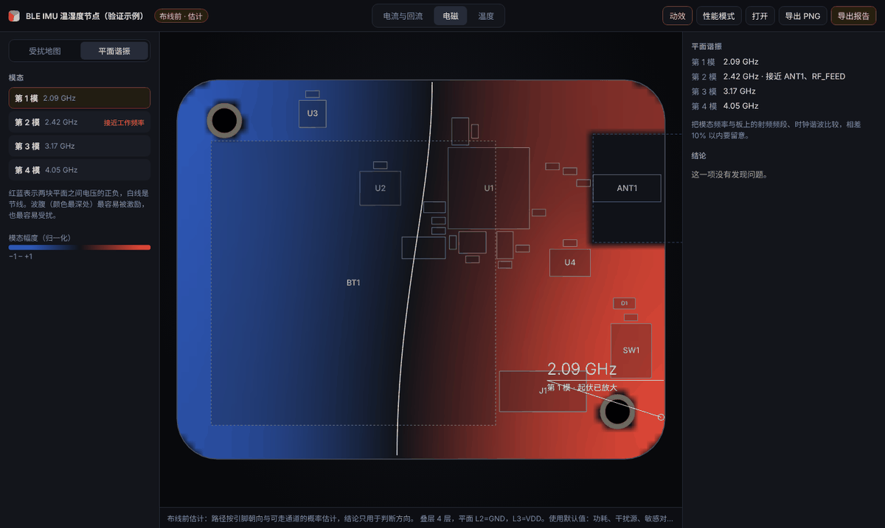
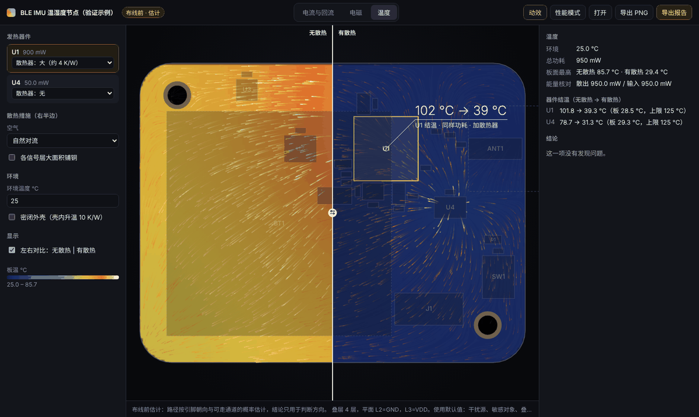
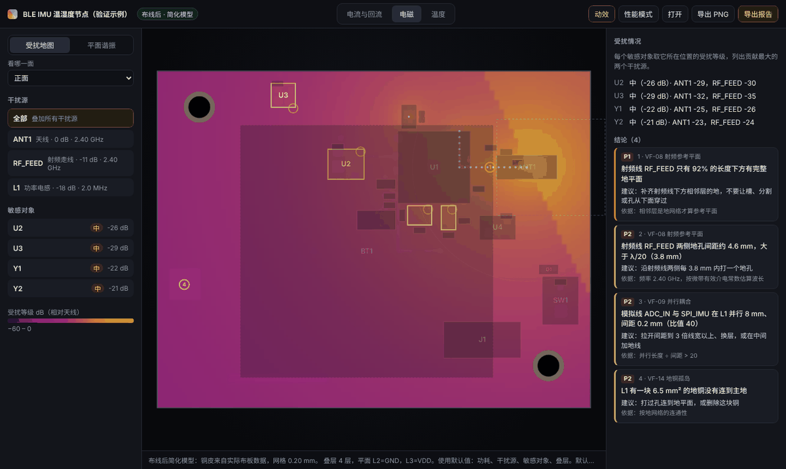

# low-power-iot-hardware-design

[](https://github.com/donghuixin/low-power-iot-hardware-design/stargazers)
[](https://github.com/donghuixin/low-power-iot-hardware-design/fork)
[](LICENSE)

一个面向**低功耗物联网硬件**的 Skill：从需求挖掘到原理图、交互式布局规划、Layout、bring-up 的完整设计与评审流程。

A Claude and Codex skill for designing and reviewing low-power IoT hardware: requirements elicitation, wireless and part selection, sensor placement, schematic reliability review, power budgeting, an interactive 2D/3D PCB placement planner, PCB layout review, and bring-up.

> **觉得有用？请点右上角 ⭐ Star，或 Fork 一份自己的副本。** 规则、参考资料和布局规划器会持续更新，Star 方便你收到更新，Fork 方便你保存自己的定制并同步上游。欢迎通过 Issue 和 Pull Request 提交改进。


## 它做什么

| 阶段 | 内容 |
|---|---|
| 1. 需求明确 | 把功能描述变成量化指标；主动提出用户没想到的需求（峰值电流、电池末期、OTA、运输模式、认证、产测……）；把需求映射到硬件形态；无线选型按数据率、吞吐、距离、峰值电流、平均功耗比较；传感器放置约束（例如 IMU 是否需要靠近转动中心） |
| 2. 原理图可靠性 | 逐状态检查每个网络：上拉下拉、开漏/推挽/三态、电平域匹配、断电域反灌；驱动电压与驱动电流；睡眠电流逐项清点与峰值电流压降；电源树、充电、保护、去耦与储能；绘制流程与可读性规范（同页直连、跨页与标准接口用标号/端口、网络命名、文字不重叠、设计意图注释） |
| 2½. 交互式布局规划 | [2D/3D 布局规划器](#交互式布局规划器)：摆放主器件，卫星器件自动贴放，实时估计布线复杂度并按规则给出问题，导出结果交回评审 |
| 2¾. 布局布线验证 | [验证器](#布局布线验证器)：电流与回流、EMI 受扰与平面谐振、温度与散热片对比；布线前按概率估计，布线后从 KiCad / Gerber 提取实际铜皮复核 |
| 3. Layout | 叠层与阻抗、布局顺序、天线与射频、电源完整性、信号完整性、晶体、高阻节点、传感器应力与热隔离、EMC/ESD、热、DFM/DFA/DFT |
| 4. Bring-up 与量产 | 上电顺序、功耗实测、常见故障排查（睡眠电流大、射频距离短、偶发复位）、认证与产测 |
| 5. 交互式引导 | 根据使用场景分轮追问，把用户确认的目标转成带单位、工况和验收方法的电路指标，并随反馈更新预算。 |
| 6. 设计资料管理 | 按设计问题请用户提供对应型号的数据手册、参考设计或原理图，记录版本与页码，让关键参数可追溯。 |
| 7. EDA 工具接入 | [设计开始时主动引导安装并验证嘉立创 EDA 或 KiCad 的 MCP](references/11-eda-mcp-setup.md)，在 Codex 或 Claude Code 中读取当前工程。 |

每个阶段输出带严重度分级（P0–P3）的问题列表，每条包含位置、后果和修改建议。

**扩展模块：高性能混合信号与医疗手持。** 设计满足任一门槛（持续功耗 >1 W、>50 MHz 或 LVDS、>50 V、FPGA、ADC ≥10 MSPS、接触人体的医疗用途）时自动启用，例如手持超声。启用后按"高压 / 漏电 / 温升 → 电源噪声 → 时钟 → 高速接口"的顺序评审，在原理图冻结前闭合功耗-热、数据率-存储、噪声-纹波、时钟抖动四项预算，并按混合信号顺序 bring-up。内容见 [`references/20`–`25`](references/20-hv-pulser-tr-safety.md) 和清单 E 段。

## 交互式布局规划器

一个可以离线打开的单文件网页（[`assets/layout-planner.html`](assets/layout-planner.html)，内置示例项目，下载后双击即可试用）。用户只摆核心器件——主控、传感器、天线、连接器、电池和板框；去耦电容、晶体、匹配网络这些小件由算法按最优策略自动贴放。每一步都告诉你这样摆对布线难度有什么影响。

### 单击拾取，卫星跟着环绕

单击托盘或板上的器件把它拿起来，光标由器件本身代替。它的卫星器件——主控周围的去耦电容、晶体及负载电容、射频匹配、DCDC 电感——跟着悬浮起来，沿两条倾斜的轨道环绕。再次单击放下，卫星从轨道飞落，按"离所属引脚最近、不挡出线、远离噪声源"的原则贴到板上最合适的位置。



拾取中按 `R` 或右键旋转 90°，点托盘放回，`Esc` 取消；习惯拖放的话，按住拖动同样可以。

动画效果默认关闭，此时卫星静止排在被拾取器件的周围；点工具条上的 **✦ 动效** 按钮打开后，才有上图的环绕、落地回弹和飞落动画。设置会记在浏览器里，系统开启"减少动态效果"时始终不播放动画。

### 2D 默认，一键切到 3D

默认是 2D 俯视，用 Canvas 绘制、不依赖 WebGL，打开即可交互。工具条正中醒目的 **2D | 3D** 按钮（快捷键 `T`）切到轻量的 3D 视图：右键拖动旋转视角、滚轮缩放、`B` 翻板看背面。Three.js 只在第一次切换时加载，不影响打开速度。两种视图共用同一份数据和交互，在 3D 里也能拾取、旋转、放下。

| 3D 视图 | 3D 中拾取主控 |
|---|---|
|  |  |

### 每一步都有反馈

- **布线复杂度**：总线长、交叉数、拥挤度峰值、关键网络、出线压力、层数建议，每项都有"良好 / 留意 / 需处理"三档和一句含义；点一下指标，画面里高亮对应的器件。规划合格的卫星器件不计入拥挤度，把挤在一起的器件移开，峰值会回落；射频馈线等关键网络按 45° 走线估计长度，"关键网络"一行直接列出超限的是哪几项。
- **本次移动说明原因**：放下或旋转后，器件旁浮起一张小卡片（如"线长 −15.0 mm、交叉 −3"），右侧写明原因，例如"交叉 +2：SPI_IMU 与 VDD 互相穿过"。
- **朝向建议**：选中器件时试算另外三个朝向，明显更好时显示半透明的幽灵朝向，按 `Enter` 采纳。


- **规则检查**：天线贴边与净空区、天线远离电池和连接器、射频馈线长度、IMU 远离板边/螺丝/热源、温湿度隔热、磁力计远离电感、电感远离天线与晶体、去耦与晶体距离、连接器开口朝外等。每条问题带 P0–P3 级别、[核对清单](references/checklists.md)编号和改法，点击即定位，并显示相关的规则区域。



- **拥挤热力图**：哪里走不出线一目了然（2D 为色块，3D 为柱高）。



### 其他细节

- **板框形状可改**：矩形/圆角矩形、胶囊形、倒角矩形、L 形、圆形，以及自定义多边形——在板上拖动顶点改形状，双击边加点、双击顶点删点；改形状后固定孔压到板边会提示。**这里的板框只用于摆放规划，布局完成后建议导出板框 DXF 和位置表，导入嘉立创 EDA 再按外壳图纸绘制最终板框。**
- **开场选定板子尺寸**：先在预设（项目原始尺寸、紧凑、常用、宽松、圆形）或自定义尺寸里选好板框，页面按器件总面积提示是否够大，同时决定固定孔：保留项目中的、四角各放一个 M2，或暂不放置；之后仍可在第 1 步或拖动板边修改。
- **固定孔可增删、可拖动**：第 1 步按 M2/M2.5/M3 添加固定孔，自动放到四角或离板边最近的空位；可以逐个改坐标和孔径，展开第 1 步时在板上直接拖动，双击孔或点 × 删除。离板边、器件或其它孔太近时会提示。
- **八步引导**：板框 → 结构定位件 → 天线 → 受物理约束的传感器 → 主控 → 电源链 → 其余主器件 → 检查与导出；步骤不强制，规则通过时打勾。
- **落点反馈**：合法为青绿，挤占别人的卫星位置或进入天线净空区为琥珀，重叠、出板、压孔为红色并抖动；松手后回到最后一个合法位置。
- **吸附与对齐**：0.5 mm 网格（按住 `Alt` 关闭），贴边器件优先吸到距板边 0.3 mm，与其他器件对齐时显示参考线。
- **不画飞线**：连接关系只参与计算，选中器件时相连器件的轮廓按网络类别着色提亮，画面保持干净。
- **导出**：布局 JSON（交回 Claude 做 Layout 评审）、位置表 CSV（EDA 摆放起点）、板框 DXF（导入嘉立创 EDA 作为初始板框）、2D 快照 PNG。
- 撤销/重做、锁定、方向键微调、动效开关（默认关闭）、深浅主题与阻焊颜色、窄屏抽屉、触屏手势、本地自动保存；画面里只有电路板和器件。

### 怎么用

在对话里让 Claude 帮你规划布局（例如"原理图画完了，帮我规划一下 PCB 上器件怎么摆"）。Claude 会：

1. 按 [`references/12-layout-planner.md`](references/12-layout-planner.md) 从原理图整理出项目数据（板框、主器件外形与引脚组、网络、卫星器件、规则参数）；
2. 运行 `python scripts/make_layout_project.py project.json` 生成该项目专用的页面交给你；
3. 你摆好后从"导出 → 布局 JSON"导出发回，Claude 按 Layout 评审的格式给出意见。
4. 把位置表 CSV 和板框 DXF 导入嘉立创 EDA 作为摆放起点，在其中按外壳图纸绘制最终板框、完成布线（Claude 可通过[嘉立创 EDA 的 MCP](references/11-eda-mcp-setup.md)协助操作）。

指标是启发式估计，用于比较不同摆法，不等于实际布线结果；默认规则参数是典型值，器件手册给出具体数值时在项目数据里覆盖。

## 布局布线验证器

和规划器分开的另一个单文件网页（[`assets/layout-verifier.html`](assets/layout-verifier.html)，内置示例，双击即可试用），专门回答"这样摆、这样布，电流怎么走、会不会互相干扰、热不热"。它在布局之后和布线之后各用一次：

- **布线前（估计）**：读入规划器导出的布局 JSON，按引脚朝向和可走通道做概率估计，告诉你供电和回流大概怎么走、哪里会挤、哪个敏感器件离干扰源太近、热点在哪，用来改摆放、指导布线。
- **布线后（简化求解）**：从 KiCad 的 `.kicad_pcb`，或 Gerber + IPC-D-356 网表（嘉立创 EDA、Altium 等）提取真实铜皮，按电源 / 模拟 / 数字 / 射频分组，只解相关的那部分铜皮，查出瓶颈、压降、过孔电流、射频参考平面缺口、并行耦合和地铜孤岛。

计算在后台 Worker 里做，求解器带多重网格预条件，一次分析在几百毫秒内完成；动效可以关，帧耗时高时自动降级。

### 电流与回流

选一个负载，供电从电源起点流过来（暖色），回流从它的地脚流回去（冷色），粒子越亮电流密度越大。高频负载的回流贴着去程走，地平面有缺口时会看到它绕路；右侧给出回路面积、建议线宽、压降和最近的去耦电容。



### 电磁：受扰地图与平面谐振

天线、射频线、开关节点、电感、时钟各自向外扩散，叠加成受扰地图，IMU、晶体、模拟网络等敏感对象按"高 / 中 / 低"脉动提示。切到"平面谐振"，看电源/地平面对的各阶模态起伏的振型、节线和频率，接近射频频段或时钟谐波时标出来。



### 温度：加散热片前后对比

逐个器件选散热片、改风速、改环境温度、打开密闭外壳，左右分屏对比改动前后，分割线可以拖动，标注直接写出"结温 102 °C → 39 °C"。



### 布线后：从实际铜皮复核

下图是一块布完线的板子：射频线下方的地平面开了槽、两侧地孔围栏太稀、模拟线贴着数字线走了 8 mm、顶层有一块没打孔的地铜，四条都被查出来并在板上定位。



### 怎么用

1. 布局摆好后，让 Claude 生成验证页面：`python scripts/make_layout_project.py 布局.json --verifier`。Claude 会先按 [`references/13-layout-verifier.md`](references/13-layout-verifier.md) 在 `verify` 块里填好负载电流和功耗。
2. 布线完成后，提供 `.kicad_pcb`（铺铜已填充）或 Gerber + 板框 + IPC 网表，Claude 用 `python scripts/extract_copper.py ... -o copper-pack.json` 提取铜皮，再加 `--copper copper-pack.json` 生成页面；也可以直接把数据包拖进页面。
3. "导出报告"得到验证报告 JSON，Claude 把其中的结论（规则 VF-01…VF-14）并入 Layout 评审。

所有结果都是简化模型的定性结论，相对比较（改动前后、方案 A 与 B）比绝对数值更可靠；不替代 SI/PI/EMC 仿真和实测。

## 目录结构

```
SKILL.md                         主流程（触发后加载）
references/
  01-requirements.md             需求维度、隐性需求、需求→硬件形态
  02-wireless-selection.md       BLE / WiFi / Thread / LoRa / 蜂窝选型
  03-sensor-placement.md         IMU、磁力计、温湿度、气压、麦克风、光学、天线的放置
  04-schematic-signals.md        信号与驱动层面
  05-power-architecture.md       电池、稳压、充电、保护、去耦
  06-power-budget.md             静态电流、峰值电流、续航
  07-layout.md                   布局布线
  08-bringup-production.md       可测试性、调试、认证、量产
  09-schematic-readability.md    原理图绘制流程与可读性规范
  10-easyeda-execution.md        嘉立创EDA 实施、器件标准化、资料归档与保存验收
  11-eda-mcp-setup.md            嘉立创 EDA 与 KiCad 的 MCP 安装、连接与排错
  12-layout-planner.md           交互式布局规划器：项目数据、功能、指标与规则、解读导出
  13-layout-verifier.md          布局布线验证器：verify 块、提取铜皮、规则 VF-01…14、解读验证报告
  20-hv-pulser-tr-safety.md      扩展：高压脉冲、T/R、高压电源与联锁、间距
  21-ultrasound-afe-clock.md     扩展：超声 AFE、采样与 IQ、时钟抖动
  22-low-noise-power-thermal.md  扩展：持续功耗模型、纹波与开关同步、手持热设计
  23-highspeed-lvds-fpga.md      扩展：LVDS、FPGA 核心板载板、数据率与 Wi-Fi 吞吐
  24-medical-handheld-safety.md  扩展：漏电、隔离、声输出、接触温度、探头头
  25-mixed-signal-bringup.md     扩展：混合信号板分级上电与测试
  checklists.md                  各阶段逐项核对清单
scripts/
  power_budget.py                功耗预算与峰值压降检查
  hw_calc.py                     I2C 上拉、储能电容、分压器、晶体负载电容、续航；抖动、纹波、高压储能、数据率
  make_layout_project.py         校验项目数据，生成布局规划页面或验证页面（--verifier / --copper）
  build_layout_planner.py        把规划器源码构建为单文件
  build_layout_verifier.py       把验证器源码构建为单文件
  extract_copper.py              从 KiCad 或 Gerber + IPC-D-356 提取铜皮，生成铜皮数据包
assets/
  layout-planner.html            布局规划器（单文件，内置示例）
  layout-planner/                规划器源码与 Three.js（MIT）
  layout-project-example.json    规划器示例项目
  layout-verifier.html           布局布线验证器（单文件，内置示例）
  layout-verifier/               验证器源码
  layout-verify-example.json     验证器示例（布局 + verify 块）
  requirements-template.md       需求与架构文档模板
  power-budget-example.json      功耗预算配置示例
tests/                           规划器与验证器的单元测试、铜皮提取测试与合成板
docs/images/                     README 配图
```

## 安装

**推荐：先 Fork，再安装你自己的副本。** 这样你对规则和参考资料的定制有地方保存，也能随时同步上游的更新。

```bash
# 1. 在 GitHub 页面右上角点 Fork，然后克隆你的副本
git clone https://github.com/<你的用户名>/low-power-iot-hardware-design.git \
  ~/.claude/skills/low-power-iot-hardware-design

# 2. 关联上游，以后用 git pull upstream main 获取更新
cd ~/.claude/skills/low-power-iot-hardware-design
git remote add upstream https://github.com/donghuixin/low-power-iot-hardware-design.git
```

只想直接使用的话：

```bash
git clone https://github.com/donghuixin/low-power-iot-hardware-design.git \
  ~/.claude/skills/low-power-iot-hardware-design
```

项目级安装则克隆到项目的 `.claude/skills/` 目录下。

**Claude 应用（claude.ai / 桌面端）**：把本仓库打包成 zip（根目录包含 `SKILL.md`），在应用的 Skills 设置中上传。

## 使用示例

- "我想做一个戴在手腕上的动作记录器，CR2032 供电，蓝牙连手机，帮我梳理硬件方案。"
- "这是我的 nRF52840 原理图，睡眠电流要做到 5 µA 以内，帮我审一下。"
- "原理图画完了，帮我规划一下 PCB 上的器件怎么摆，天线放哪里。"
- "板子回来后睡眠电流有 300 µA，预期是 4 µA，怎么查？"
- "帮我看看这个 2.4 GHz 板载天线的 layout 有没有问题。"

## 脚本

```bash
python scripts/power_budget.py assets/power-budget-example.json
python scripts/hw_calc.py i2c-pullup --vdd 1.8 --cb-pf 40 --speed 400k
python scripts/hw_calc.py bulk-cap --ipeak-ma 15 --pulse-ms 5 --dv 0.2
python scripts/hw_calc.py divider --vin 4.2 --r1 2e6 --r2 1e6
python scripts/hw_calc.py xtal --cl-pf 9 --cstray-pf 3
python scripts/hw_calc.py jitter --fin-mhz 10 --snr-db 74
python scripts/hw_calc.py hvcap --cel-pf 100 --channels 32 --dv 60 --tr-ns 20 --droop-v 1 --cycles 8 --prf-khz 10
python scripts/make_layout_project.py assets/layout-project-example.json --check
python scripts/make_layout_project.py assets/layout-verify-example.json --verifier
python scripts/extract_copper.py board.kicad_pcb --project 布局.json -o copper-pack.json
```

除 `extract_copper.py`（需要 numpy、scipy、Pillow）外只依赖 Python 3 标准库。规划器与验证器的单元测试：`node --test tests/*.test.js`（Node 18+，无第三方依赖）；铜皮提取：`python -m unittest tests/test_extract_copper.py`。

## 参与改进

- 发现规则或参考资料有误、想补充某类器件的放置规则：提交 [Issue](https://github.com/donghuixin/low-power-iot-hardware-design/issues)。
- 想直接改：Fork 后在分支上修改，提交 Pull Request。规划器改动请附上 `node --test tests/*.test.js` 的结果和截图。
- 喜欢这个项目，请点 ⭐ Star，让更多做低功耗硬件的人看到它。

## 说明

文档中的数值均为典型量级，用于判断方向和发现问题；具体设计请以所选器件的 datasheet、参考设计和硬件设计指南为准，并以实测验证。

## License

[MIT](LICENSE)。布局规划器内置的 Three.js 同为 MIT 许可，见 [`assets/layout-planner/vendor/three.LICENSE`](assets/layout-planner/vendor/three.LICENSE)。
