# 布局布线检查助手 / Layout & Routing Check Assistant

嘉立创 EDA 专业版扩展。布局和布线之前，先和设计者逐级确认设计信息；按板子的功能梳理网络优先级并逐档确认；对照确认内容检查器件摆放；按成文的走线规则检查布线、打分，用板子动画讲清楚问题；确认放行后一键修复几何问题（所有拐角都是 135°，不留直角）。可以接入你自己的大模型，也可以通过本地桥让本机的 AI 客户端（Claude Code、Codex 等）调用。

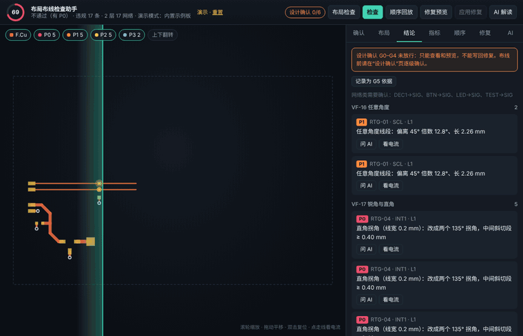

**分步演示**（演示板：BLE 运动传感器节点，走线全部为 135° 拐角）：

| ① 逐级确认 | ② 布局检查 |
|---|---|
|  | 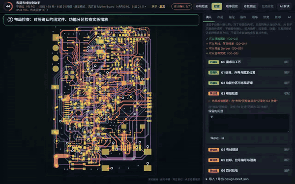 |
| 每级核对摘要后手动输入确认码；前面改了，后面自动失效 | 功能分区扫入、器件按功能块落位；净空区、目标位置、去耦回路逐条动画 |
| **③ 优先级逐档确认** | **④ 布线检查与修复** |
| 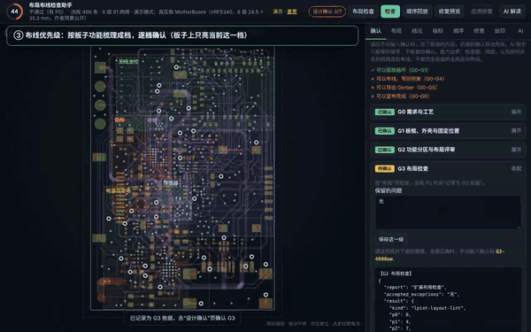 | 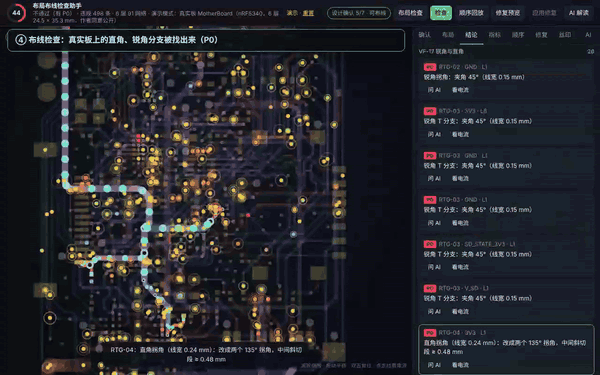 |
| 按板子功能梳理 9 档，板子上只亮当前这一档的网络，逐档确认 | 去耦回路、差分与回流、顺序回放；修复预览红线 → 绿线，修复后没有直角 |

> **这不是一键出板工具。** DRC 通过不代表板子能用。没有说清外壳和接口位置、没有功能分区、没有布线优先级就让工具“自动布完”，得到的往往是满板任意角度和长绕线。所以写回修复前必须先在“确认”页逐级确认，AI 代理也绕不过去。

## 使用

1. 在扩展广场安装，或在 高级 → 扩展管理器 → 导入 选择 `.eext` 文件。
2. 打开 PCB，菜单 **布局布线检查 → 打开布局布线检查面板**。
3. **确认**页：逐级填写并确认 G0 需求与工艺、G1 板框外壳与固定件、G2 功能分区（附上你看过的布局截图）。
4. 点 **布局检查**，在“布局”页看问题和动画；没有 P0 时点“记录为 G3 依据”，回到“确认”页确认 G3。
5. G4 里点 **从板子梳理**（或“让 AI 结合功能梳理”），按档位逐档核对网络、理由、走法和规则，逐档点确认；全部确认后再确认 G4。
6. 点 **检查** 看布线结论；“修复预览”随时可看，G0–G4 放行后才能“应用修复”。修改放在一个操作里，可以撤销。应用后请重新铺铜并跑一次 DRC。
7. 布完后在“结论”页记录为 G5 依据，填 DRC 错误数和截图，确认 G5。

菜单里的 **快速布局检查**、**快速布线检查** 只弹出问题数和最严重的几条。

## 设计确认（强制）

| 级别 | 要你给出并确认 |
|---|---|
| G0 需求与工艺 | 功能与场景、供电与峰值电流、无线、环境、层数、板厚、板厂 |
| G1 机械约束 | 板框尺寸或外壳 DXF、外壳材料与限高、固定孔、每个接口 / 按键 / 灯 / 天线 / 电池贴哪条边和位置、禁布区 |
| G2 功能分区 | 功能块与区域、信号与电源流向、你看过的布局截图 |
| G3 布局检查 | “布局”页检查无 P0，记录为依据；保留的问题 |
| G4 布线规划 | 每层用途、**布线优先级逐档确认**、差分对、电源电流、验收分数 |
| G5 交付验收 | 布线得分达标且无 P0、DRC 为零、你看过的布线截图 |

每一级填完后显示摘要和确认码（如 `G1-4c09ae`），核对无误后手动输入确认码，再在编辑器弹窗里点确认。前面的内容一改，后面的确认自动失效。设计确认按工程保存在本机，可以和命令行 `design_gate.py` 使用的 `design-brief.json` 互相导入导出（导入后需要重新确认）。

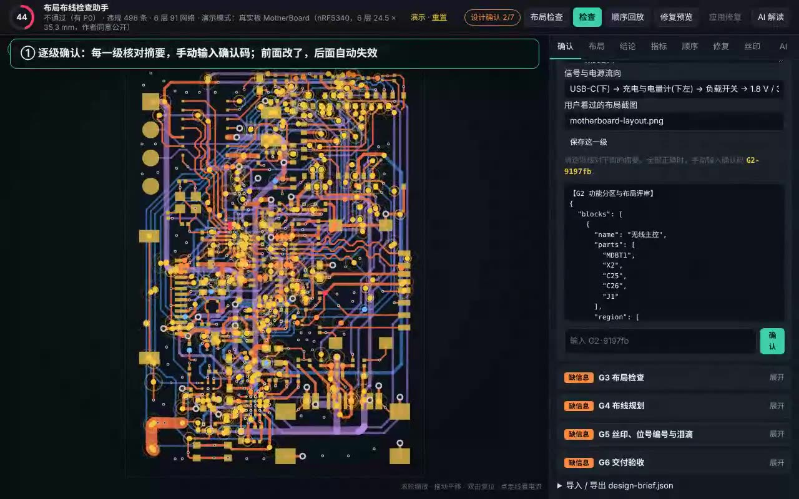

## 布线优先级：按功能梳理，逐档确认

助手根据网络名、连接的器件（按位号和型号判断角色：天线、晶振、DCDC、IMU、USB 接口……）和网络类，把网络分成 9 档：射频与天线 → 时钟源 → 开关回路与高压 → 高速差分 → 单端时钟 → 模拟敏感 → 电源 → 一般信号 → 地。每档写明为什么排在这里、每个网络在电路里的作用、建议走法（手工 / 工具辅助 / 铺铜）和规则。配置了大模型时，可以让 AI 结合器件型号修正（例如把芯片内部稳压的去耦脚归到电源档）。

逐档确认：点一档，板子上只亮这一档的网络并流动显示；核对无误点“确认第 N 档”，自动跳到下一档。档位确认码由这一档和前面所有档的内容算出，挪动网络或改走法后，从这一档往后要重新确认。AI 代理只能梳理和填写，不能确认。

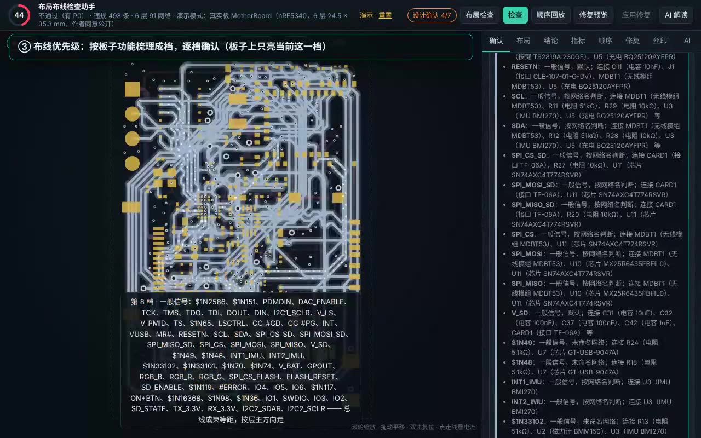

## 布局检查

对照设计确认内容检查当前摆放：

- **机械与分区**：器件超出板框、焊盘区域重叠、固定件没贴指定的边或位置不对、器件进禁布区、功能块的器件跑出自己的区域、功能块交叠、主器件没分到功能块；
- **射频与干扰源**：天线不在板边、净空区里有器件；天线与电池 / 连接器、电感与天线、电感与晶振、晶振与天线的间距；
- **传感器与热**：IMU 离板边、连接器、按键、固定孔太近（应力），IMU / 温湿度 / 晶振 / 电池离 DCDC、LDO、充电芯片太近（热），磁力计离电感和电池太近，功率电感离敏感传感器太近，电源流向绕路；
- **就近**：去耦电容、晶振负载电容、ESD、串阻、地过孔的距离（没布线时按直线距离估计）。

动画：功能分区依次扫入，器件按功能块着色落入；选中问题会画出目标位置、器件滑向目标的示意和箭头，间距问题显示两侧辐射的“场”和距离，禁布区和天线净空用流动斜线标出，去耦问题画出电流回路面积。

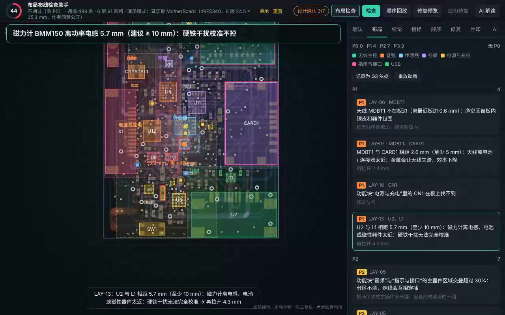

嘉立创 EDA 自带的 DRC 管连通性、间距、线宽、过孔、差分对和元件间距（装配干涉）；“这个器件该不该放在这里”这类检查由本扩展补上。

## 布线检查

**走线几何**：直角拐角（**不接受**，所有网络类含电源和地线，P0；拐角只许 135°）、任意角度（线段只许 0/45/90/135° 方向）、锐角拐角与锐角 T 分支、短碎线段、Z 形抖动、斜着出焊盘、线宽中途变化、悬空线头、没声明豁免的圆弧。

**网络类约束**：自动推导网络类（射频、晶振、开关节点、USB、差分、时钟、模拟、电源、地、一般信号），检查线宽下限、每网过孔预算、盘中孔、换层回流地过孔、绕行率、晶振线长、2 层板底层跳线、内层地上走线。

**走线原则**：就近（去耦电容到电源引脚 ≤ 3 mm、电容与芯片同层不隔过孔、地焊盘旁有地过孔、负载电容贴晶振、ESD 在接口 5 mm 内且串在线上、串阻贴驱动端）；差分（同层、并行、等距、等长、过孔成对、中间不穿线）；关键信号优先（抓优先级倒挂）；隔离（开关节点、时钟、高速差分不与模拟、晶振、射频长距离并行）；裸露焊盘过孔阵列。

14 项指标加权成 100 分，任一 P0 即不通过。规则、阈值和出处见 [low-power-iot-hardware-design](https://github.com/donghuixin/low-power-iot-hardware-design) 的 references/16–19。

| 去耦回路 | 差分对与回流 | 布线顺序回放 | 修复预览 |
|---|---|---|---|
| 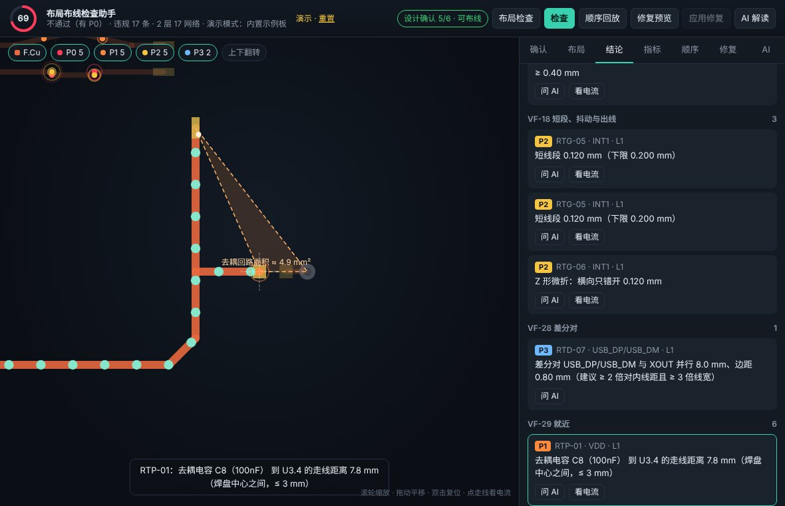 | 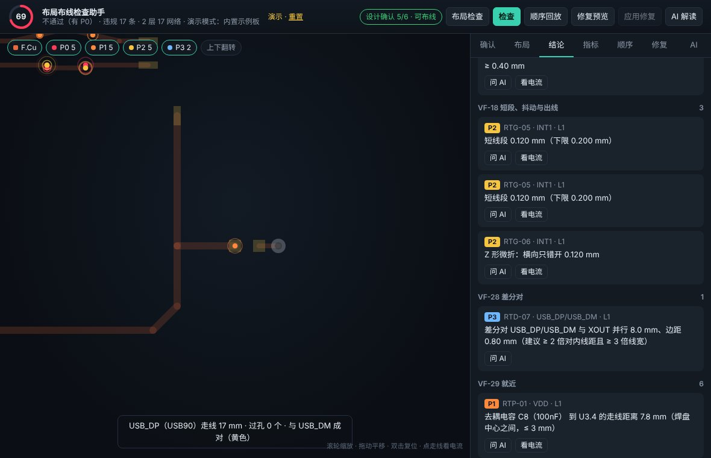 | 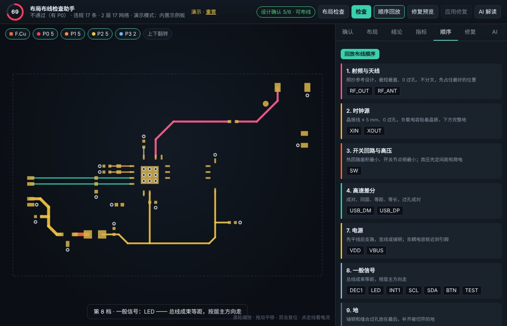 | 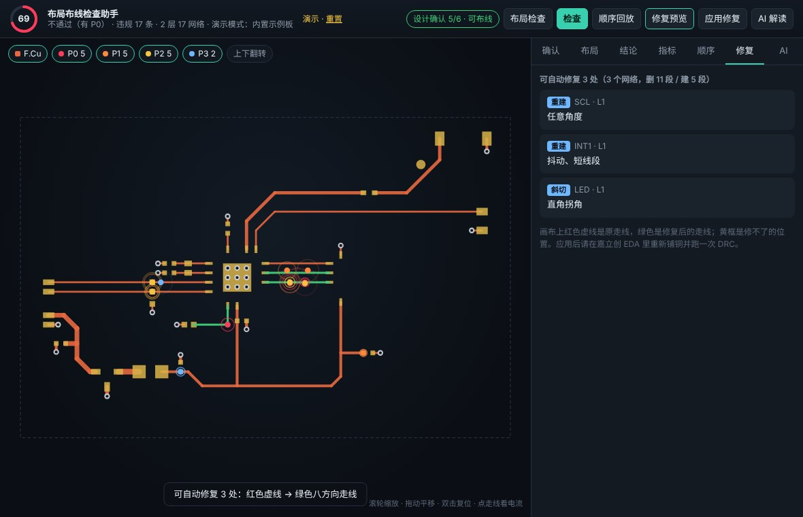 |

- **电流流动**：点一根走线，电流沿铜皮从芯片端流向各个焊盘；差分对两根同步流动。
- **回流路径**：信号换层的过孔到最近地过孔的回流路径用流动虚线画出，超过 2 mm 标橙色。
- **去耦回路**：画出 芯片引脚 → 电容 → 地过孔 的电流回路，面积越大越红。
- **布线顺序回放**：按优先级档位逐网“生长”出走线，字幕说明这一档为什么先布。
- **修复预览**：红色虚线是原走线，绿色是修复后的走线。直角斜切成两个 135° 拐角（斜切段优先 max(2w, 0.2 mm)，空间不够时缩短），任意角度、抖动、斜出焊盘重建为八方向折线；修不了的位置画黄框，列为人工处理。

## AI 与本地联动

- **你自己的大模型**：在面板“AI”页的设置里选择 Anthropic Claude 或 OpenAI 兼容接口（DeepSeek、通义、Kimi、本地 Ollama 等），填写地址、模型和 API Key。用于整板解读、单条问答和按功能梳理优先级。API Key 只保存在本机扩展配置里。
- **本机 AI 客户端和脚本**：扩展广场的安装包不含本地桥；从 [GitHub](https://github.com/donghuixin/low-power-iot-hardware-design/tree/main/eext/lpiot-layout-routing-check/bridge) 获取，`npm install` 后运行 `node bridge.mjs --mcp`（MCP，给 Claude Code 等）或 `node bridge.mjs`（HTTP + 令牌，给脚本），再在菜单点 **连接本地 AI 助手…**；连过一次后自动重连。多个 AI 客户端共用一条到编辑器的连接。代理可以检查、定位、梳理优先级、布局检查、读取和填写设计确认、导出板子数据、预览修复；没有任何确认工具，G0–G4 未放行时写回和写入前闸门会被拒绝，放行后写回仍会弹窗请你确认。拓扑和接口说明见源码仓库 `references/26-eda-link.md`。

Claude Code 的 MCP 配置示例：

```json
{ "mcpServers": { "lpiot-eda": { "command": "node", "args": ["/path/to/eext/lpiot-layout-routing-check/bridge/bridge.mjs", "--mcp"] } } }
```

调用模型和连接本地桥都需要在 **扩展管理** 里开启本扩展的 **外部交互** 权限。

## 说明与局限

- 修复只改几何（走线段），不改过孔、换层和连接关系；空间不够的标为需要人工处理。
- 直角拐角按交付标准一律不接受：在这类板子的频段内它的电气影响很小，但为了一致、可检查和密度，规则不留例外。
- 地平面破碎度在编辑器内没有栅格化计算，按铺铜覆盖范围粗略判断；需要精确值时用源码仓库的 `extract_copper.py`。
- 器件角色按位号和型号推断，位号和型号都不按惯例的器件可能认不出来，可以在设计确认的 `roles` 里指定。
- 没有画板框时，布局检查按器件包络估计板子范围，板边和分区检查不准。

## 开发

```bash
npm install
npm test          # 核心与 Python 版逐条对齐（布线、布局、确认码、优先级）、修复、扩展适配层（假 eda 对象）、本地桥
npm run build     # 打包面板、生成 build/dist/*.eext，并按官方开发指南做上架自检（npm run check:store）
```

源码与规则：https://github.com/donghuixin/low-power-iot-hardware-design/tree/main/eext/lpiot-layout-routing-check

许可：Apache-2.0。基于嘉立创官方 easyeda-api-sdk 搭建。

---

**English**: An EasyEDA Pro extension with a mandatory design-confirmation gate (requirements, enclosure and fixed parts, functional partition, layout check, routing plan with tier-by-tier net-priority confirmation, acceptance — confirmed by the user in the panel; agents cannot confirm), a layout checker against the confirmed brief (fixed parts, partitions, keepouts, antenna clearance, IMU stress and heat, magnetometer, decoupling), and a routing checker (135° corners only — no right angles, arbitrary or acute angles, pad exits, vias, proximity, differential pairs, priority) with board animations, fix preview and apply, your own LLM, and a local bridge (MCP / HTTP with token) for AI clients and scripts.
