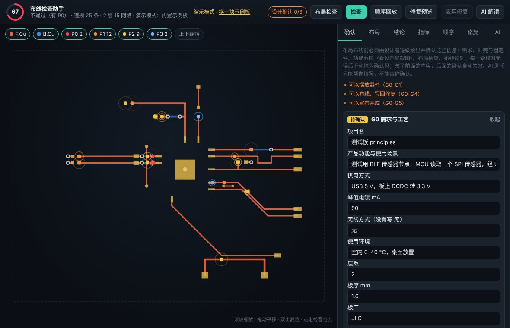
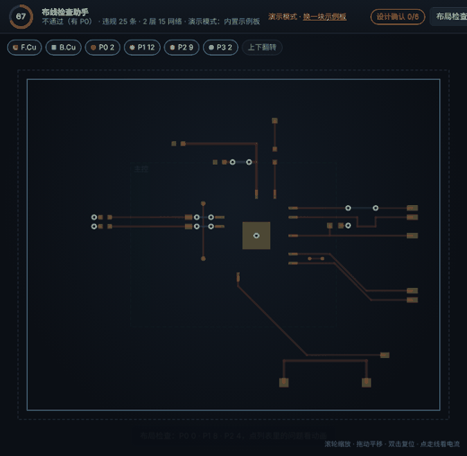
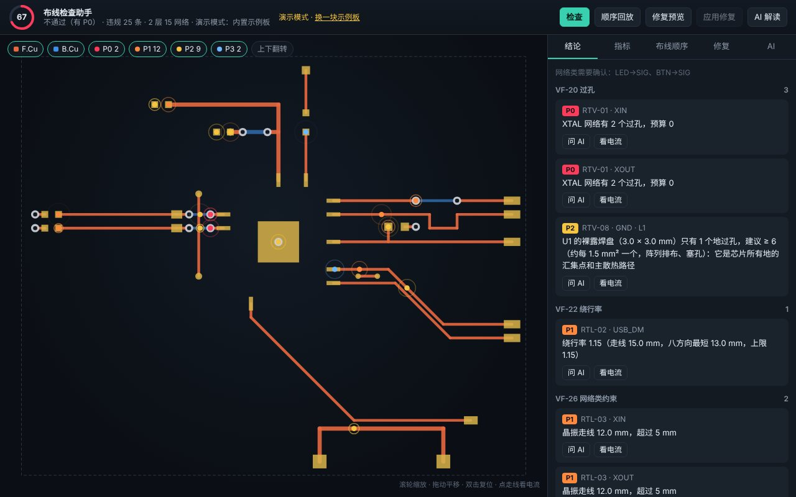
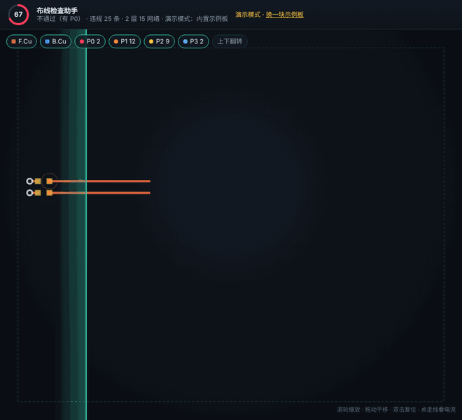
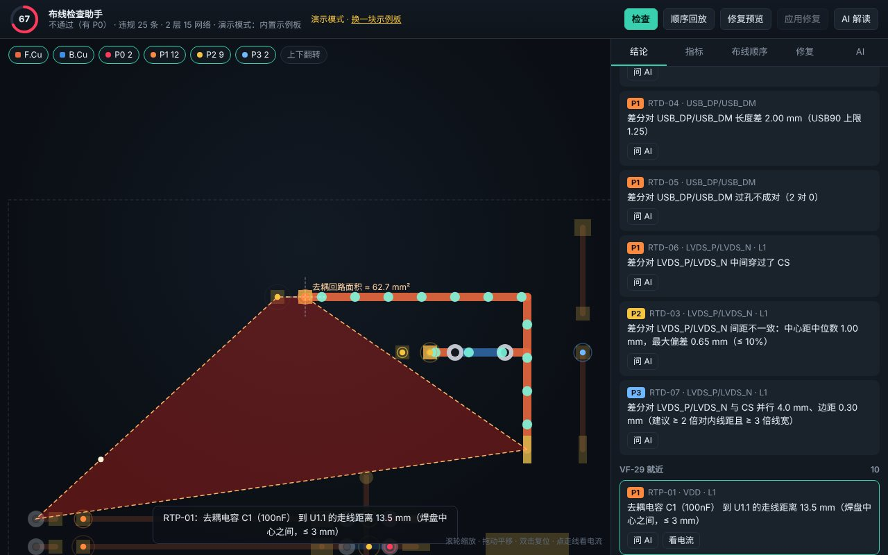
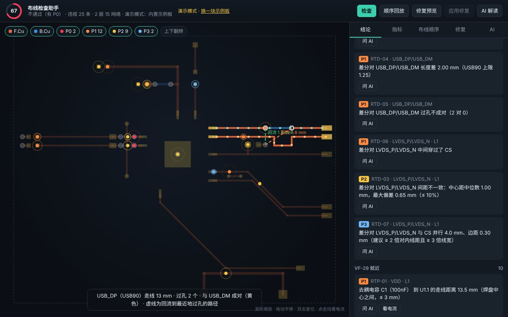
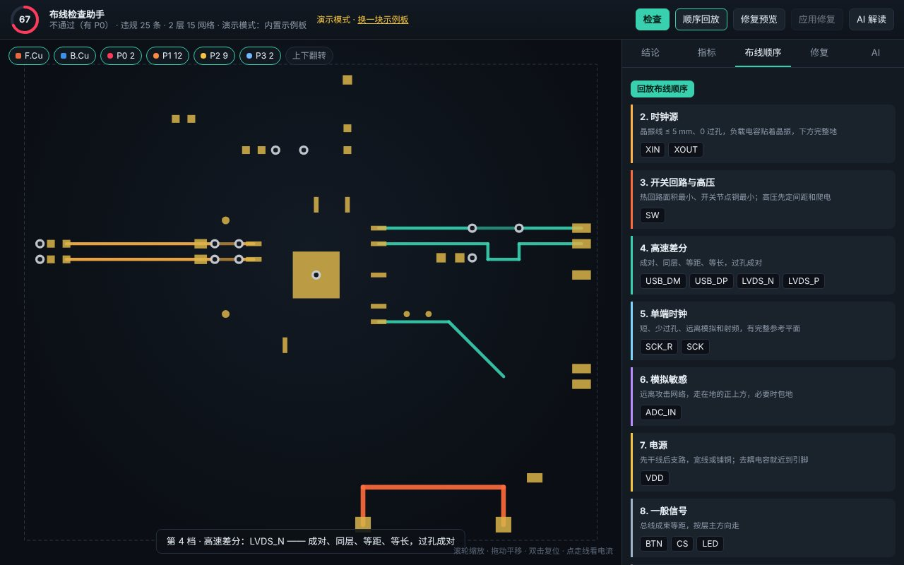
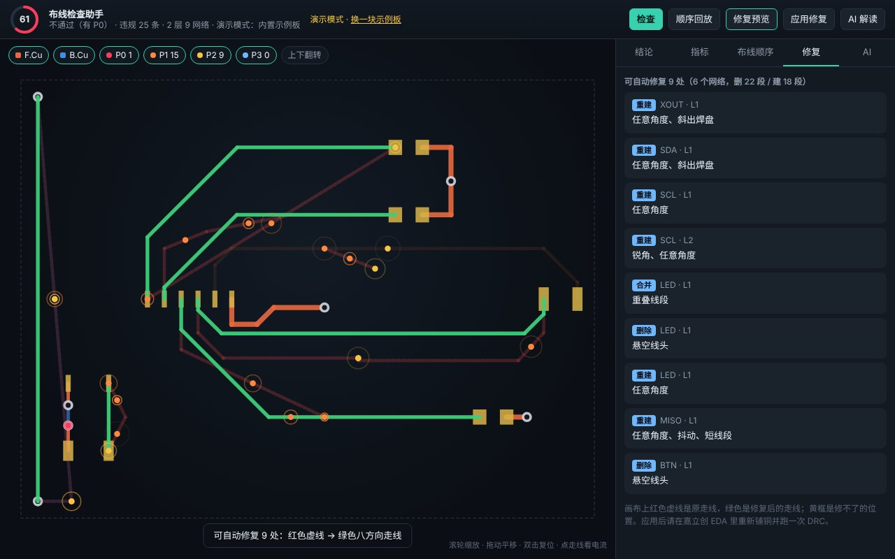

# 布线检查助手 / Routing Check Assistant

嘉立创 EDA 专业版扩展。布局布线之前先和你逐级确认设计信息；对照确认内容检查器件摆放；读当前 PCB，按一套成文的走线规则检查、打分、用板子动画讲清楚问题在哪；设计确认放行后能一键修复几何问题；还能接入你自己的大模型做解读。

> **这不是一键出板工具。** DRC 通过不代表板子能用。没有说清外壳和接口位置、没有功能分区、没有布线优先级就让工具“自动布完”，得到的往往是满板任意角度和长绕线。所以写回修复前，必须先在“设计确认”页逐级确认，AI 代理也绕不过去。

## 设计确认（强制）

| 级别 | 要你给出并确认 |
|---|---|
| G0 需求与工艺 | 功能与场景、供电与峰值电流、无线、环境、层数、板厚、板厂 |
| G1 机械约束 | 板框尺寸或外壳 DXF、外壳材料与限高、固定孔、每个接口 / 按键 / 灯 / 天线 / 电池贴哪条边和位置、禁布区 |
| G2 功能分区 | 功能块与区域、信号与电源流向、你看过的布局截图 |
| G3 布局检查 | “布局”页检查无 P0，点“记录为 G3 依据”；保留的问题 |
| G4 布线规划 | 每层用途、布线优先级（哪些手工、哪些可工具辅助）、差分对、电源电流、验收分数 |
| G5 交付验收 | 布线得分达标且无 P0（“结论”页记录）、DRC 为零、你看过的布线截图 |



每一级填完后，面板显示摘要和确认码（如 `G1-4c09ae`），核对无误后手动输入确认码，再在编辑器弹窗里点确认。前面的内容一改，后面的确认自动失效。G0–G4 都确认后才能写回修复。设计确认按工程保存在本机，也可以导入 / 导出命令行 `design_gate.py` 使用的 `design-brief.json`（导入后需要重新确认）。

## 布局检查

点“布局检查”，对照设计确认内容检查当前摆放：器件超出板框、焊盘区域重叠、固定件没贴指定的边或位置不对、功能块器件跑出自己的区域、功能块交叠、天线不在板边或净空区里有器件、天线 / 电感 / 晶振 / 电池 / 连接器间距不够、器件进禁布区、去耦电容和晶振负载电容离得太远。动画：功能分区依次扫入、器件按功能块着色落入；选中问题会画出目标位置、器件滑向目标的示意和箭头，间距问题显示两侧辐射的“场”和距离。



嘉立创 EDA 自带的 DRC 管连通性、间距、线宽、过孔、差分对和元件间距（装配干涉）；“这个器件该不该放在这里”这类检查由本扩展补上。





## 能查什么

**走线几何**：直角拐角（**不接受**，所有网络类含电源和地线，P0；拐角只许 135°）、任意角度（线段只许 0/45/90/135° 方向）、锐角拐角、锐角 T 分支、短碎线段、Z 形抖动、斜着出焊盘、线宽中途变化、悬空线头、没声明豁免的圆弧。

**网络类约束**：自动推导网络类（射频、晶振、开关节点、USB、差分、时钟、模拟、电源、地、一般信号），检查线宽下限、每网过孔预算、盘中孔、换层回流地过孔、绕行率、晶振线长、2 层板底层跳线、内层地上走线。

**走线原则**：
- 就近：去耦电容到电源引脚 ≤ 3 mm、电容与芯片同层不隔过孔、地焊盘 0.5 mm 内有地过孔、负载电容贴晶振、ESD 在接口 5 mm 内且串在线上、串阻贴驱动端；
- 差分：同层、并行耦合、线距一致、对内等长（USB ≤ 0.5 mm、LVDS ≤ 0.13 mm）、过孔成对、中间不穿线；
- 关键信号优先：射频 → 晶振 → 开关回路与高压 → 高速差分 → 时钟 → 模拟 → 电源 → 一般信号 → 地，抓“关键网络被一般信号挡路而绕行或打孔”的优先级倒挂；
- 隔离：开关节点、时钟、高速差分不与模拟、晶振、射频长距离并行；
- 裸露焊盘过孔阵列、多个地网络提醒。

14 项指标加权成 100 分，任一 P0 即不通过。规则、阈值和出处见 [low-power-iot-hardware-design](https://github.com/donghuixin/low-power-iot-hardware-design) 的 references/16–18（参考 ADI AN-1142、TI ZHCAAE6B、Espressif / Nordic 硬件设计指南等）。

## 动画

| 去耦回路 | 差分对与回流 | 布线顺序回放 | 修复预览 |
|---|---|---|---|
|  |  |  |  |

- **扫描入场**：检查完成后扫描线掠过板子，违规点随之亮起，按严重度着色脉冲。
- **电流流动**：点一根走线，电流沿铜皮从芯片端流向各个焊盘；电源慢、时钟快；差分对两根同步流动（黄色为配对线）。
- **回流路径**：信号换层的过孔到最近地过孔的回流路径用流动虚线画出，超过 2 mm 标橙色。
- **去耦回路**：选中去耦电容的问题，画出 芯片引脚 → 电容 → 地过孔 的电流回路，面积越大越红。
- **布线顺序回放**：按优先级档位逐网“生长”出走线，字幕说明这一档为什么先布。
- **修复预览**：红色虚线是原走线，绿色是修复后的八方向走线，修不了的位置画黄框。所有网络上的直角拐角都会被斜切成两个 135° 拐角（斜切段优先 max(2w, 0.2 mm)，空间不够时缩短），切不了的列为人工处理。

## 使用

1. 在扩展广场安装，或在 高级 → 扩展管理器 → 导入 选择 `.eext` 文件。
2. 打开 PCB，菜单 **布线检查 → 打开布线检查面板**。先到“设计确认”页填写并确认 G0、G1；摆好器件后截图确认 G2；点“布局检查”，没有 P0 就记录为 G3 依据并确认；填好 G4 布线规划并确认。
3. 点“检查”看布线结论。
4. 点右侧结论定位到画布和编辑器里的图元；点“看电流”看动画；“布线顺序”页可回放推荐顺序。
5. “修复预览”随时可以看；G0–G4 确认后才能“应用修复”。修改放在一个操作里，可以撤销。应用后请重新铺铜并跑一次 DRC。
6. 布完后在“结论”页记录为 G5 依据，填 DRC 错误数和截图，确认 G5。

**快速检查**菜单只弹出得分和最严重的几条。

## AI

- **AI 解读**：在面板“AI”页的设置里选择 Anthropic Claude 或 OpenAI 兼容接口（DeepSeek、通义、Kimi、本地 Ollama 等），填写地址、模型和你自己的 API Key。整板解读会把检查报告、网络类和布线顺序发给模型；单条违规的“问 AI”会附上附近 3 mm 内的网络。API Key 只保存在本机扩展配置里。
- **本地 AI 代理**：从源码目录运行 `npm install && npm run bridge`（HTTP，`POST http://127.0.0.1:49732/rpc`）或 `node bridge/bridge.mjs --mcp`（MCP，给 Claude Code 等用），再在菜单点 **连接本地 AI 助手…**。代理可以调用检查、布线顺序、定位、修复预览、布局检查、读取和填写设计确认；没有确认工具，G0–G4 未放行时写回和写入前闸门会被拒绝；放行后写回修复时嘉立创 EDA 仍会弹窗请你确认。

Claude Code 的 MCP 配置示例：

```json
{ "mcpServers": { "lpiot-routing": { "command": "node", "args": ["/path/to/eext/lpiot-routing-check/bridge/bridge.mjs", "--mcp"] } } }
```

调用模型和连接本地桥都需要在 **扩展管理** 里开启本扩展的 **外部交互** 权限。

## 说明与局限

- 修复只改几何（走线段），不改过孔、换层和连接关系；空间不够的标为需要人工处理。
- 直角拐角按交付标准一律不接受：在本类板子的频段内它的电气影响很小，但为了一致、可检查和密度，规则不留例外。
- 地平面破碎度在编辑器内没有栅格化计算，按铺铜覆盖范围粗略判断；需要精确值时用源码仓库的 `extract_copper.py`。
- 器件角色按位号推断（C 电容、R 电阻、D/TVS/ESD、U 芯片、J 接口、Y/X 晶振），位号不按惯例的器件可能认不出来。
- 阈值是工程经验值，可以在源码 `src/core/model.ts` 里调整。

## 开发

```bash
npm install
npm test          # 核心与 Python 版逐条对齐、修复、扩展适配层（假 eda 对象）、MCP 桥
npm run build     # 打包面板、生成 build/dist/*.eext，并按官方开发指南做上架自检（npm run check:store）
```

源码与规则：https://github.com/donghuixin/low-power-iot-hardware-design/tree/main/eext/lpiot-routing-check

许可：Apache-2.0。基于嘉立创官方 easyeda-api-sdk 搭建。

---

**English**: An EasyEDA Pro extension with a mandatory design-confirmation gate (requirements, enclosure and fixed parts, functional partition, layout check, routing plan, acceptance — each confirmed by the user typing a code; agents cannot confirm), a layout checker against the confirmed brief, and a routing checker that checks PCB routing against written rules (octilinear geometry, net-class constraints, proximity, differential pairs, routing priority, isolation), scores it, explains issues with board animations (current flow, return paths, decoupling loops, routing-order replay, fix morphing), previews and applies geometry fixes as one undoable command group, and connects to your own LLM or a local AI agent (HTTP / MCP bridge).
